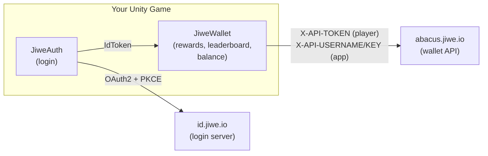
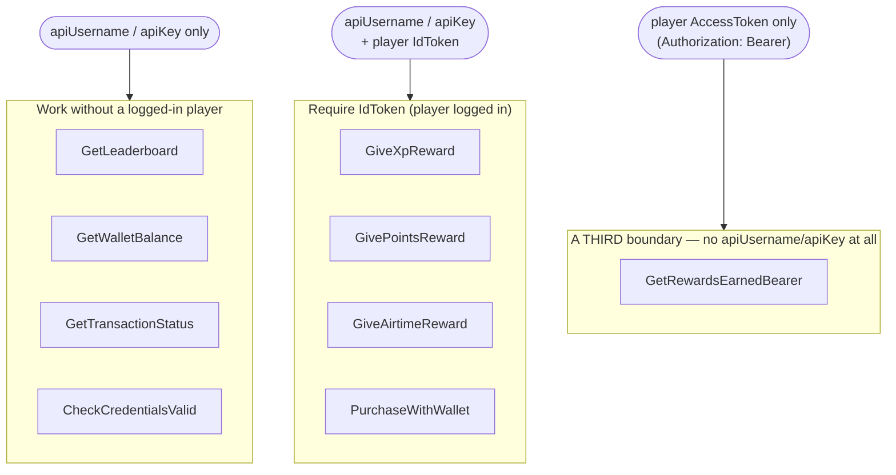
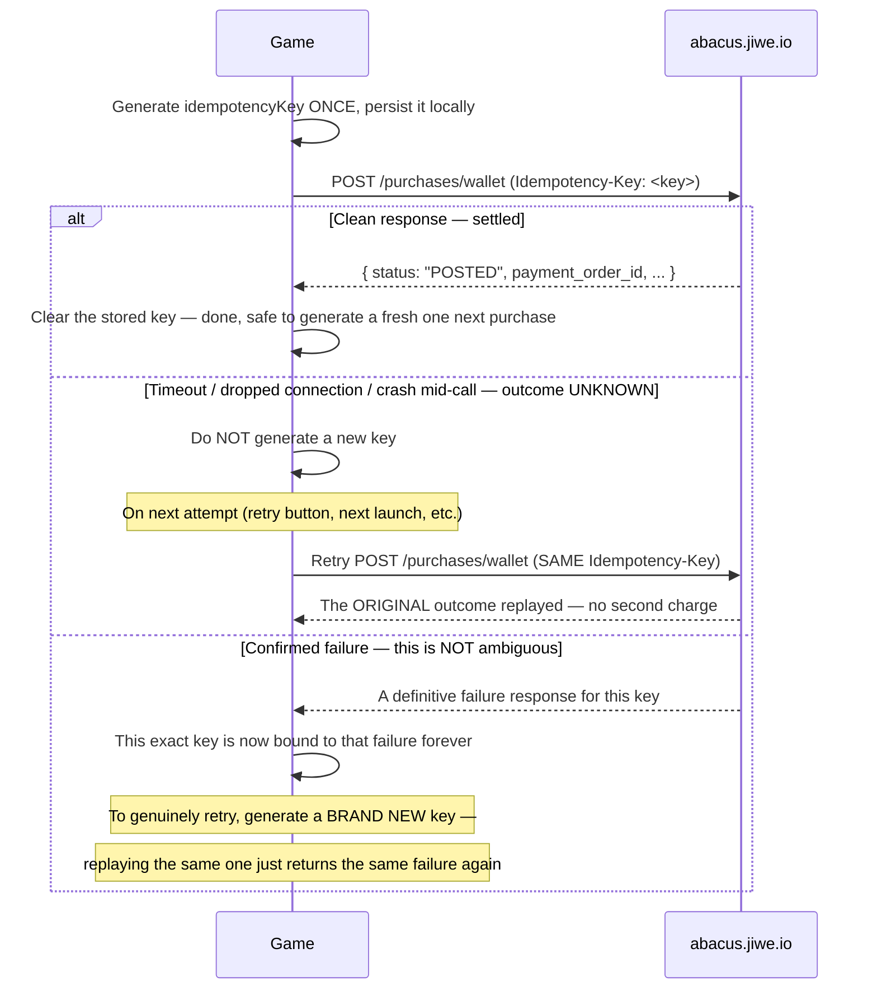
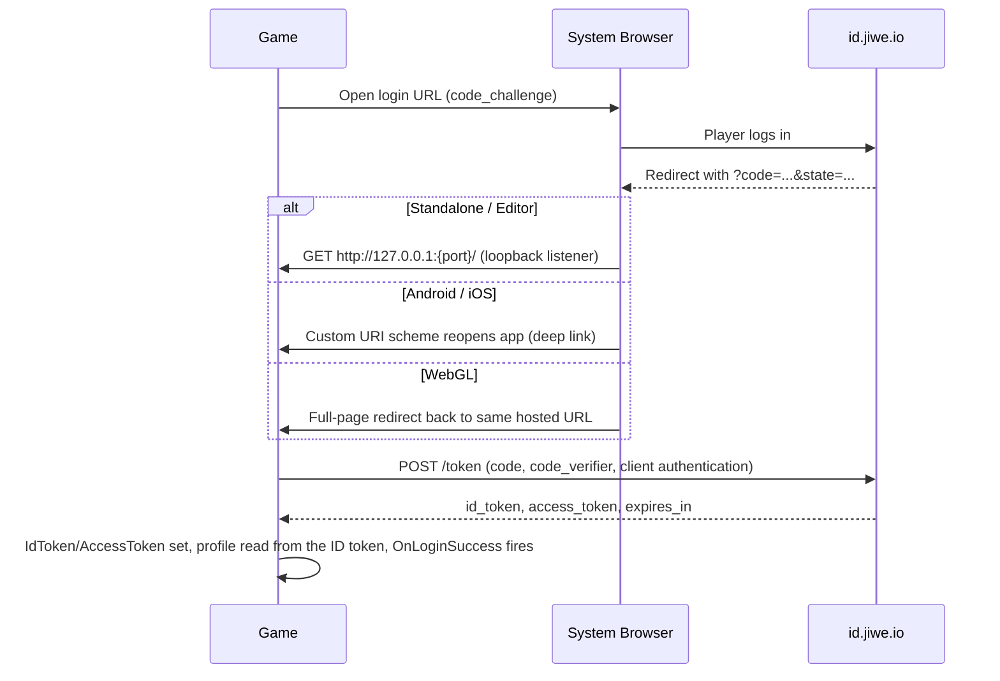
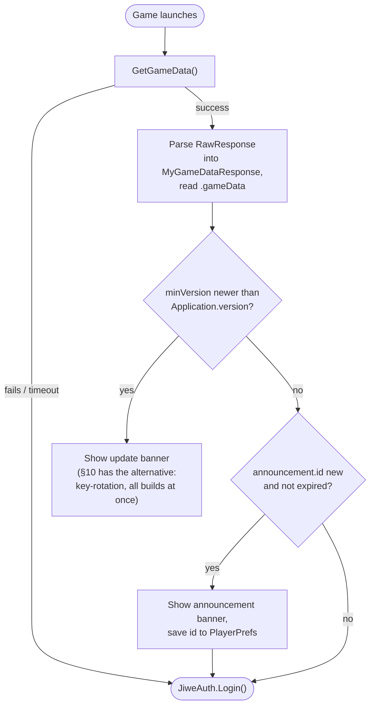

# Jiwe Wallet SDK for Unity

Log players into Jiwe with OAuth2 + PKCE, then credit them XP/points/airtime and read
leaderboard/wallet data — against Jiwe's real, live API (`id.jiwe.io` for auth,
`abacus.jiwe.io` for wallet calls).

Two scripts and one WebGL plugin, no dependencies: `JiweAuth.cs` handles login,
`JiweWallet.cs` handles everything else, and `Plugins/WebGL/JiweStorage.jslib` makes the
WebGL login redirect work. Copy the whole `Jiwe/` folder into `Assets/` and you're done
importing.

**Where this SDK sits relative to Jiwe's docs.** Jiwe publishes its API at
[developers.jiwe.io](https://developers.jiwe.io) (sign-in required). That site is the
source of truth for what the API *accepts*; this SDK is the source for what has been
*proven to work in shipped games* — and every method in §5 says which of the two it
rests on. Where they disagree, this README says so. Real code from three of those games
is in [docs/use-cases.md](docs/use-cases.md).

> **This doc is Unity-specific.** The concepts below — two credential pairs, the
> redirect-URI model, the reward/leaderboard/purchase API shape, the security
> rules, the Game Data patterns — are the same on any engine. If you're building
> the Unreal or Godot SDK next, §2, §3, §5, §6, §9, §10, and §11 are the ones to
> port; §4 (Quickstart), §7 (per-platform login mechanics), and §8 (WebGL export
> settings) are Unity/C#-specific.

---

## 1. Architecture at a glance



`JiweAuth` logs a *player* in and produces an `IdToken`. `JiweWallet` uses that token
for player-scoped calls, plus a separate static credential pair for app-scoped calls.
They're independent components wired together by one Inspector reference
(`JiweWallet.auth`).

---

## 2. Two credential pairs — don't confuse them

This is the single most common integration mistake: there are **two unrelated
credential pairs**, not one.

| Pair | Lives on | Identifies | Required for |
|---|---|---|---|
| `clientId` + `apiSecret` | `JiweAuth` | your **app**, used to run OAuth login | Logging a player in at all |
| `apiUsername` + `apiKey` | `JiweWallet` | your **app**, sent as `X-API-USERNAME`/`X-API-KEY` | Every wallet API call, even before login |

Get all four by logging in at [www.jiwe.io](http://www.jiwe.io) → **Profile** →
**My Apps** → **Create an Application** — one application per game. **Before you
open that form, read §3** — it asks for a Redirect URI you need to have decided
already, not something to improvise mid-form.



Unlike an older version of this SDK, there **is now** a real purchase (charge-the-
player) endpoint — `PurchaseWithWallet`, debiting the player's own Jiwe balance.
See §6 for the full flow; it has a real double-charge footgun if you get the retry
handling wrong, so it's worth reading before you wire it up.

`GetRewardsEarnedBearer` doesn't fit the two-pair model above at all — it's a third,
separate authentication boundary ("Hermes OIDC bearer" in Jiwe's docs) that uses
only the player's own `AccessToken`, no static credentials whatsoever. Jiwe's
docs say mixing API-key headers into a request on this boundary is refused
outright. The player-scoped calls above send `X-API-TOKEN` — the ID token or the
access token, see §7. See §6.

---

## 3. Redirect URIs — decide these *before* you create your app

The app-creation form (§2) has a **Redirect URIs** field that's blank by default,
with no platform default shown in the UI. **Jiwe doesn't generate or infer this
value — you define it yourself, once, in the form** — and it must then match,
exactly, whatever `redirect_uri` your build actually sends on login. Decide these
per platform *before* you fill in the form, using what `JiweAuth` actually sends:

| Platform | `redirect_uri` the SDK sends | Register this |
|---|---|---|
| Standalone / Editor | `http://127.0.0.1:<port>/` — a **random free port each login** unless you set `JiweAuth.loopbackPort` | Set `loopbackPort` (e.g. `53682`) and register `http://127.0.0.1:53682/` |
| Android / iOS | `<mobileRedirectScheme>://oauth-callback` — default scheme `jiwewallet` | `jiwewallet://oauth-callback` (or your own scheme, kept in sync with `JiweAuth.mobileRedirectScheme`) |
| WebGL | `JiweAuth.webglRedirectUri` if set, otherwise the page's own URL with the query string and `#fragment` removed | That exact URL — one entry **per environment** (local/staging/production) |

> **Standalone/Editor: set `loopbackPort`.** Left at `0`, the SDK asks the OS for a free
> port every login, so the redirect URI changes each time and can never match the one
> you registered. Set a fixed port on the `JiweAuth` component, register exactly
> `http://127.0.0.1:<that port>/`, and pick a port that is free on your players'
> machines. (Earlier versions of this README told you to edit `GetFreeLoopbackPort()`
> in the SDK source; you no longer need to.)

> **WebGL: your page URL is already one fixed value, but you probably deploy to
> several**, and each needs its own exact entry in the Redirect URIs field (it accepts a
> comma-separated list):
> - **Local testing**: serve the build from a **fixed, predictable URL** (always
>   `http://localhost:8000/`), not whatever port a dev server picks that day.
> - **Staging and production**: register each as a separate exact entry.
> - **A host that changes the page path per release breaks an exact match.** If your
>   build is served under a versioned path, the default (the page URL) differs every
>   release. Set **`JiweAuth.webglRedirectUri`** to a stable entry page and register that
>   instead. JiweChess does this: its WebGL build registers its host's origin plus `/`
>   (e.g. `https://host.example/`), for exactly this reason.
> - **Must match byte-for-byte**, including any trailing slash. Ask Jiwe which URL your
>   host actually serves your game at before registering it.
> - **CORS is a separate ask from redirect_uri registration.** Registering a URL does
>   not whitelist it for the browser-side token exchange — ask Jiwe (§12) to
>   CORS-whitelist every domain you registered, at the same time.
> - **Don't confuse this field with "Website."** The form also has a **Website**
>   field (your profile or studio URL) that is unrelated to login and never has to match
>   anything your build sends.

The same form also has an **"My app will..."** scope checklist — check every scope
the SDK actually requests (`openid`, `profile`, `in-app-purchases`, `rewards`; see
the `Scope` constant in `JiweAuth.cs`). Leaving one unchecked produces the same
undiagnosable `access_denied` redirect as a missing `scope` param — decide this
alongside your redirect URIs, not after a failed login. **The checkboxes don't
show the raw scope names** — `openid`/`profile` are labeled plainly ("Identify
and log in users" / "Read the user's name and avatar," both marked `required`),
but `in-app-purchases` and `rewards` both appear as separate `legacy`-tagged
checkboxes reading **"Include the user's wallet ID in the token"** — check both
of those too, not just the two `required` ones, or reward calls will fail even
though login succeeds.

---

## 4. Quickstart

1. **Decide your redirect URIs and scopes** — see §3. Do this first; you need the
   values in hand for step 2.
2. **Get credentials.** Log in at [www.jiwe.io](http://www.jiwe.io) → **Profile** →
   **My Apps** → **Create an Application**, entering the redirect URIs/scopes from
   step 1, to generate `clientId` / `apiSecret` / `apiUsername` / `apiKey` for this
   game.
3. **Import.** Copy the whole `Jiwe/` folder (`JiweAuth.cs`, `JiweWallet.cs` and
   `Plugins/WebGL/JiweStorage.jslib`) into `Assets/`. No Newtonsoft dependency — it uses
   Unity's built-in `JsonUtility`.
4. **Wire it up.** Create an empty GameObject ("JiweSDK"), add both `JiweAuth` and
   `JiweWallet` to it, and drag the `JiweAuth` component into `JiweWallet.auth`.
5. **Fill in credentials** on the two components (see the table in §2). Do this via a
   gitignored config asset, not hardcoded — see §9.
6. **Run.** With `loginOnStart` checked (default), the login page opens automatically;
   `JiweAuth.OnLoginSuccess` fires once `IdToken` is populated. Standalone/Editor: set
   `loopbackPort` first (§3). If login fails at the token step, see "How the client
   secret is presented" in §7.
7. **Building for WebGL?** Set your export/compression settings per §8 before your
   first upload — a wrong Compression Format is the single most common reason a
   build "uploads fine" but shows a blank page.

```csharp
jiweAuth.OnLoginSuccess += () => {
    jiweWallet.GiveXpReward(20, "Reward for passing boss#1", result => {
        if (result.Success) Debug.Log("XP awarded!");
        else Debug.LogWarning($"XP reward failed: {result.Error}");
    });
};
```

**Want a working starting point instead?** [`Samples/`](Samples) has seven drop-in starters taken from our
shipped games — guest-first setup, XP + leaderboard, an update gate, a cosmetic shop, cloud saves, an airtime
milestone, and a server in front of Jiwe. Each is one component that draws its own UI, so add it to a
GameObject and press Play. See [Samples/README.md](Samples/README.md).

---

## 5. API reference

All calls are async/callback-based; every result carries `Success` + `Error` (+
call-specific fields).

"Evidence" says how far to trust each row: **Live** = running in a shipped Jiwe
game (KentePunk, Sheng Word League, JiweChess); **Docs** = matches Jiwe's supported
reference but we haven't exercised it ourselves — verify before depending on it.

| Method | Login? | Evidence | Notes |
|---|---|---|---|
| `GiveXpReward(xp, description, onComplete, transactionId?)` | Yes | Live | XP has no monetary value. `transactionId` is only sent if you pass one |
| `GivePointsReward(points, description, onComplete, transactionId?)` | Yes | Docs | "Cowrie" points. Auto-generates a `transactionId` |
| `GiveAirtimeReward(units, phoneNumber, description, onComplete, transactionId?)` | Yes | Live | Min. 5 units; real airtime, asynchronous — see §6 |
| `PurchaseWithWallet(amount, itemId, description, idempotencyKey, onComplete)` | Yes | Live | Debits the player's own balance. `idempotencyKey` is not optional — §6 |
| `GetPurchaseStatus(paymentOrderId, onComplete)` | Yes | Docs | Poll a purchase by the `PaymentOrderId` from its result |
| `GetRewardsEarned(onComplete)` | Yes | Live | Player's lifetime earned points/XP/airtime. **Not a spendable balance** — §6 |
| `GetRewardsEarnedBearer(onComplete)` | Yes | Docs | Same totals, no API key; needs `rewards:read` + `walletResource` — §6 |
| `GetUserData(onComplete)` / `SetUserData(json, onComplete)` | Yes | Live | Per-player storage (cloud saves, unlocks) — §11 |
| `GetLeaderboard(rewardType, maxEntries, period, bestPointsRanking, onComplete)` | No | Live | `rewardType`: `"xp"`\|`"cowrie"`; `period`: `"day"`\|`"week"`\|`"month"`\|`"year"`\|`null`. Read `entry.Score` |
| `GetWalletBalance(onComplete)` | No | Live | **Your app's** float, not a player's |
| `GetTransactionStatus(transactionId, onComplete)` | No | Live | Poll a `LedgerTransactionId`; read `result.Status` |
| `GetGameData(onComplete)` / `SetGameData(json, onComplete)` | No | Live | App-wide storage, **public to every player** — §11 |
| `CheckCredentialsValid(onResult)` | No | Live | Key-rotation forced update — §10 |

**What every result carries.** All wallet results include `Success` and `Error`;
`JiweWalletResult` and `JiwePurchaseResult` also give you:

| Field | Meaning |
|---|---|
| `HttpStatus` | The HTTP status; `0` means no response arrived (timeout/connection failure) — or that nothing was sent because you weren't logged in |
| `Retryable` | `true` for no-response, `429` and `5xx` — per Jiwe's Errors page, retry those with backoff (and for money, with the **same** idempotency key). `false` for every other failure: a 4xx is a definitive answer that won't change |
| `LedgerTransactionId` | The handle for `GetTransactionStatus`. Store it before you tell the player anything |
| `Status` | `PENDING` / `POSTED` / `ARCHIVED` / `FAILED` / `REVERSED` on a status response |

Branch on `HttpStatus`, not on the response's `type`: Jiwe says `OK` and `SUCCESS` are
not interchangeable per endpoint, and `message` is prose for your logs, not a stable
error code.

```csharp
jiweWallet.GetLeaderboard("xp", maxEntries: 20, period: null, bestPointsRanking: "highest", result => {
    if (!result.Success) return;
    // Server order isn't guaranteed — sort it yourself, and read Score (see the note below).
    var rows = new List<JiweLeaderboardEntry>(result.Entries);
    rows.Sort((a, b) => b.Score.CompareTo(a.Score));
    for (int i = 0; i < rows.Count; i++) Debug.Log($"{i + 1}. {rows[i].name} — {rows[i].Score}");
});
```

> **Leaderboard scores are in different fields depending on the board.** The live
> API sends a period board's score as an **uppercase `XP`** (JsonUtility is
> case-sensitive, so reading `xp` gives 0 for every row) and a player's lifetime total
> as `currentXP`; `xp` mostly appears in doc samples. `entry.Score` picks the
> non-zero one for you. KentePunk also sorts rows locally and recomputes rank, because
> a server-supplied rank can disagree with the order it sent.

---

## 6. In-app purchases

`PurchaseWithWallet` debits the logged-in player's **own** Jiwe balance for an
in-game item — a real purchase endpoint, unlike an older version of this SDK
which had none. Per Jiwe's docs: *"A purchase never partially applies. If
anything fails, no money moves."*

> **Request fields: `amount`, `itemId`, `description`, `metadata`.** That's the
> `WalletPurchase` schema in Jiwe's *supported* API reference (v1.0.15).
> Jiwe's hand-written "Take a payment" guide shows `entityId`/`entityName`/
> `gamerWalletId` on this endpoint instead — those are the fields of the separate
> `purchases/adhoc` endpoint and aren't in this endpoint's schema, so don't use
> them here. The newer v1.0.16
> reference also shows an optional `potId`; it isn't in the supported version, so
> it isn't exposed here.

> **The price is whatever the client sends.** Jiwe carries `itemId` onto the
> record but "never prices or validates" it (`catalogPriceValidated` is a field
> on the response, not something you can rely on being enforced). A modified
> client can change `amount` before it's sent, so a purchase issued directly from
> a shipped build is only as trustworthy as that build — fine for low-stakes
> cosmetics, not for anything where underpaying is a real loss. For those, price
> on your own server and call this endpoint from there.

### Many calls here are accepted, not settled

`PurchaseWithWallet` isn't always a same-request success/fail — Jiwe's own docs
describe it as asynchronous, and the HTTP status tells you which case you're in:

| Status | Meaning |
|---|---|
| `200` | Done. The response is the final result. |
| `201` | Created and handed to a payment rail — not yet settled. |
| `202` | Accepted for processing — not yet settled. |

A `201`/`202` still carries a `ledger_transaction_id` — that's your handle on
the eventual outcome, and `result.Success` being `true` in the SDK does **not**
by itself mean the purchase settled. The underlying transaction then moves
through its own states:

| State | Meaning |
|---|---|
| `PENDING` | Recorded, not settled. |
| `POSTED` | Settled. Immutable. |
| `ARCHIVED` | Closed without posting. |
| `FAILED` | Did not complete. |
| `REVERSED` | Posted, then reversed by a compensating transaction. |

**Don't unlock the item until `Status == "POSTED"`** — treat `RequiresApproval:
true` or any non-`POSTED` status as "not yet paid," and poll
`GetPurchaseStatus(result.PaymentOrderId, ...)` (with backoff — start around a
second and grow the interval, don't tight-loop) until it settles one way or the
other.

### `idempotencyKey` is not optional — get the retry logic right

Reusing the same key on a retry returns the **original** outcome instead of
charging twice. But that only protects you if you reuse it correctly — get the
distinction below wrong and it's a real double charge, not a theoretical one.



The mistake this exists to prevent isn't "forgetting" the key — it's treating
**every** retry the same way. There are two genuinely different situations:

- **Ambiguous outcome** (timeout, dropped connection, app crash before the
  response arrived) — you don't know what happened, so reuse the *same* key.
  That's the safe case this mechanism is for.
- **Confirmed failure** (a definitive error response came back for that key) —
  that key is now permanently bound to that failure. Replaying it returns the
  *same failure* again, not a fresh attempt. A genuine retry after a confirmed
  failure needs a **new** key, because it's a new operation.

Reusing a key for a request with **different contents** (a different amount or
item) is rejected outright with a `409` and executes nothing — the key is
bound to what it was first used for, so this fails safely rather than doing
something unexpected.

Which failures are "ambiguous" is not a judgement call — Jiwe's Errors page lists
them, and the SDK sets `result.Retryable` from that table:

| Status | What it means | `Retryable` | Same key? |
|---|---|---|---|
| `0` (no response) | Timeout / dropped connection — you can't tell whether it arrived | yes | **same** |
| `429` | Rate limited — not processed | yes, with backoff | **same** |
| `500`, `503` | Server fault / dependency down | yes, with backoff | **same** |
| `400`, `403`, `404`, `422` | Definitive — "the outcome will not change" | no | **new** key for any genuine retry |
| `409` | That key was already used for a *different* request; nothing ran | no | original request, or a new key |

This is not theoretical. Sheng Word League hit it live: a player topped up their
wallet after a failed purchase and stayed stuck, because the stored key kept being
honored and kept replaying the old rejection. Its rule — "any 4xx except 429 is
definitive; only 429 and 5xx are worth retrying with the same key" — is exactly the
`Retryable` flag.

```csharp
string keyPref = $"purchase_key_{itemId}";
string key = PlayerPrefs.GetString(keyPref, "");
if (string.IsNullOrEmpty(key)) {
    key = Guid.NewGuid().ToString("N");
    PlayerPrefs.SetString(keyPref, key);
    PlayerPrefs.Save(); // persist BEFORE the network call — a crash mid-purchase must not lose this
}

jiweWallet.PurchaseWithWallet(150, itemId, "Nebula skin", key, result => {
    if (result.Success && !result.RequiresApproval && result.Status != "PENDING") {
        PlayerPrefs.DeleteKey(keyPref);            // settled — the next purchase gets a fresh key
        GrantItem(itemId);
    } else if (result.Success) {
        PollPurchaseStatus(result.PaymentOrderId); // accepted, not settled: do NOT grant yet
    } else if (result.Retryable) {
        ShowRetry("Couldn't confirm the purchase. Try again — you won't be charged twice.");
        // keep the SAME key: the next attempt replays whatever really happened
    } else {
        PlayerPrefs.DeleteKey(keyPref);            // definitive: a later attempt is a NEW purchase
        ShowFailure(result.Error);
    }
});
```

- **Generate the key once, before the first attempt** — not inside a retry helper,
  not fresh on every call.
- **Persist it to disk before the network call**, not just in memory — a crash or
  force-quit between "purchase sent" and "response received" is the case this exists for.
- **One key per logical purchase** (KentePunk keys by item), never reused for a
  different amount or item. Max 200 characters.
- Retry with exponential backoff (a second, then two, then four); Jiwe rate-limits tight
  loops, which only delays the answer you wanted.
- Keep your reason for failure out of the player's face: a raw `message` is prose that
  "may be reworded." Sheng Word League maps definitive rejections to "You haven't been
  charged" and 5xx/network to "check your balance, then try again" — it deliberately
  doesn't promise "you weren't charged" on a 5xx, because a 500 can land after the debit.

### When the player can't afford it

Jiwe has **no endpoint that returns a player's current wallet balance**, so a purchase
you can't cover is only discovered by attempting it. Sheng Word League treats HTTP
`422` ("well formed but could not be applied") as the primary insufficient-funds signal,
with a keyword match on the message (`insufficient`, `not enough`, `balance`) as a
fallback. That rule is a best guess — Jiwe's Errors page documents no message for
insufficient balance, and it hasn't been confirmed against a deliberately drained
wallet. Treat it as a hint for friendlier wording, never as a guarantee.

### Reading what a player has earned

`GetRewardsEarned` returns the logged-in player's **lifetime earned** points, XP and
airtime, scoped to your app. That is **not a spendable balance** — points the player
has since spent aren't subtracted — so don't show it as "you have N cowrie to spend."
It's the call KentePunk runs live: API key + `X-API-TOKEN`, no extra setup.

```csharp
jiweWallet.GetRewardsEarned(result => {
    if (result.Success) Debug.Log($"XP {result.XP} · points {result.Points} · airtime {result.AirtimeEarned} {result.AirtimeCurrency}");
});
```

`GetRewardsEarnedBearer` asks the same question through Jiwe's player-facing "Hermes
OIDC bearer" boundary instead — `Authorization: Bearer <access_token>` and **no API
key at all**, which is what Jiwe recommends from a player's own device. Jiwe says the two
boundaries are mutually exclusive (a request carrying both is refused). It's documented
but **not yet verified live in this SDK**, and it needs two opt-in login settings:

| `JiweAuth` field | Set to | Why |
|---|---|---|
| `extraScopes` | `rewards:read` | `GET /oidc/rewards/earned` requires it; a token without it gets `403` (not `401`, so refreshing won't help). Also enable it on your app's registration form. |
| `walletResource` | your Wallet API resource identifier | Sent as `&resource=`. Without it the access token is for the *default* resource, "which is not the Wallet API," and Wallet calls return `401`. Jiwe issues the identifier during onboarding — ask for yours. |

```csharp
jiweAuth.extraScopes = "rewards:read";
jiweAuth.walletResource = "<your Wallet API resource identifier>";
// ...after login:
jiweWallet.GetRewardsEarnedBearer(result => { /* points, XP; AirtimeEarned reads 0 here */ });
```

It uses `JiweAuth.AccessToken`, never the ID token. The access token lives about 15
minutes for the Wallet API and a public client can't get a refresh token, so after
`jiweAuth.IsAccessTokenExpired` the answer is to send the player back through `Login()`.

The same boundary also has `GET /oidc/metadata/game-data` (`game-data:read`) and
`GET /oidc/metadata/user-data` (`user-data:read`) — reads that need no API key, which
would let the §11 patterns run without embedding `apiKey` for those calls. Not wired up
yet.

### What's deliberately not implemented yet

Jiwe's API reference lists more than this SDK wraps. Where each stands:

| Endpoint(s) | Why it isn't here |
|---|---|
| `rewards/cowrie`, `rewards/data` | Their per-type request bodies aren't legible in the published schema (only the shared `RewardBase` fields are). Check Jiwe's *Schemas* section and a live request before adding |
| `airtime/adhoc-wallet-purchase`, `data/adhoc-wallet-purchase` | Debit a **developer wallet** (`walletId`, `requestor`) — server-to-server, not something a player's device should call |
| `rewards/summary`, `rewards/e/{jiweUserId}`, `leaderboard/sync` | Reconciliation and reporting over many players — backend tooling |
| `purchases/adhoc`, `*/adhoc-mpesa-purchase` | Take fresh M-Pesa/card payment; the payment flow belongs behind your own server |
| `notifications/*`, `/user/notifications/inbox` | An admin publish API plus a signed-in player's inbox (Bearer). Looks like the right fit for persistent in-game messages, but its schemas haven't been exercised here |
| subscriptions, campaigns, pots, limits, accounts | Business/admin surface |

A rule worth keeping from the one mistake this SDK made: the API reference's
auto-generated *examples* are admitted to be "not accurate," and Jiwe's hand-written
guide disagreed with the reference on this very purchase endpoint (the reference was
right — see the note at the top of this section). Trust the **Schemas** section of the
supported reference, then a live request, before either.

---

## 7. Login flow, per platform

`JiweAuth` runs standard OAuth2 Authorization Code + PKCE, but how the browser hands
control back to your game is inherently different per platform — this is the one part
of the SDK that can't be unified. (For what `redirect_uri` to register for each of
these, see §3 — decide that *before* your first login test.)



| Platform | Mechanism | Extra setup |
|---|---|---|
| Standalone / Editor | Local loopback HTTP listener catches the redirect | Set `loopbackPort` and register that URI — see §3 |
| Android / iOS | System browser → custom URI scheme (`mobileRedirectScheme`) reopens the app | Register that redirect URI with Jiwe — see §3 |
| WebGL | The **same tab** navigates to Jiwe and back to your page with `?code=...`; the page reloads and resumes | Import `Jiwe/Plugins/WebGL/JiweStorage.jslib` (it ships with the SDK); Jiwe must allow CORS from your hosted domain; see §3 and §8 |

**WebGL needs the bundled `.jslib`.** Unity's own calls get three things wrong for
this one flow, each found by live testing on a hosted build: `Application.OpenURL`
always opens a *new* tab (so the original tab sat on "Signing in…" while a second tab
logged in with nobody listening), `PlayerPrefs` is asynchronous on WebGL (the PKCE
verifier can be lost when the page unloads), and the address bar keeps the single-use
`?code=` after the redirect. `JiweStorage.jslib` fixes all three with a synchronous
`localStorage` write, an in-place navigation and a query clean-up. Copy the whole `Jiwe/`
folder, including `Plugins/`, into `Assets/`.

### How the client secret is presented

Jiwe's token endpoint has asked for the client secret in **different places at different
times**, and the evidence from our own games disagrees:

| Where it was seen | What worked | What failed |
|---|---|---|
| KentePunk, Android (July) | secret in the **form body** | omitted → `401 invalid_client` |
| Sheng Word League backend (Jul–Sep) | `Authorization: Basic` header, **nothing** in the body | both at once → `400 client authentication must only be provided using one mechanism` |
| JiweChess, hosted WebGL (2026-09-09) | `Authorization: Basic` header | secret in the body → `400` |

Jiwe's docs only say a confidential client "authenticates itself with its client secret"
and that a device-resident app "holds no secret." So `JiweAuth.clientAuth` is a setting:

- **`Auto` (default)** — Basic first; if Jiwe rejects the client authentication (`401`, or
  the `400` "one mechanism" error), retry **once** with the secret in the body.
- **`BasicHeader`** / **`RequestBody`** — pin one once you know your environment. Pinning
  skips the extra request and any chance a failed first attempt matters.
- **Empty `apiSecret`** — sends `client_id` only (a public client with PKCE, as the docs
  describe). Whether *your* Jiwe app accepts that is between you and Jiwe.

If login fails with `invalid_client`, a `400` mentioning client authentication, or
"token exchange failed" right after the browser step, this is the first thing to check.

### What you get back after login

| Property | What it is |
|---|---|
| `IdToken` | Proof of sign-in. Sent as `X-API-TOKEN` by default (see below) |
| `AccessToken` / `AccessTokenExpiresAtUtc` / `IsAccessTokenExpired` | The access token and its lifetime. Documented as ~15 minutes for the Wallet API; a public client can't refresh it, so once expired send the player back through `Login()` |
| `UserInfo` (`sub`, `name`, `nickname`, `bio`, `picture`, `walletId`) | Read from the **ID token's own claims**. Jiwe's `/me` endpoint has been seen rejecting every token (confirmed live 2026-09-14), so the SDK no longer depends on it; it still tries `/me` to fill any gaps. `walletId` is only present if the `rewards` or `in-app-purchases` scope was granted |
| `IsLoggingIn` | `true` from `Login()` until it succeeds, fails or is cancelled — use it to disable your own "Log in" button. A second `Login()` while one is running is ignored with a warning |

Key your own player records by **`sub`** — it's the only stable identifier. Email and
phone change, and Jiwe's profile doesn't reliably include a phone number: Sheng Word
League once keyed airtime claims by phone, and one account claimed twice for the same
puzzle.

**Which token is `X-API-TOKEN`?** Jiwe's reference calls it "a Hermes **access** token,"
but KentePunk and Sheng Word League have shipped for months sending the **ID** token and
it works; JiweChess switched to the access token after reading the docs. Both can be
right: an access token only works as `X-API-TOKEN` if it's audienced to the Wallet API
(`walletResource`). So `JiweWallet.playerTokenKind = Auto` sends the access token when
`walletResource` is set and the ID token otherwise. Force one with `IdToken` /
`AccessToken` if Auto doesn't match what your environment accepts.

`networkTimeoutSeconds` (default 20s) bounds every step of this flow — a hung browser
or dead network fails visibly instead of hanging forever. **Always** also wire a
Skip/Cancel button, clickable the *entire* time login is in progress. `Cancel()` also
makes the SDK ignore a deep link that arrives late, so a slow OS hand-back can't log a
player in after they've moved on:

```csharp
skipButton.onClick.AddListener(() => {
    jiweAuth.Cancel(); // safe to call unconditionally, even if nothing's in progress
    ShowMainMenuAnonymously();
});
```

---

## 8. WebGL export settings for Jiwe hosting

Before uploading a WebGL build to Jiwe hosting, set these in **Edit → Project
Settings → Player → WebGL → Publishing Settings**:

| Setting | Required value | Why |
|---|---|---|
| Compression Format | `Disabled` | Both compressed options have real, hosting-breaking failure modes — see below |
| Decompression Fallback | `Off` | Not needed once compression is disabled |

Yes, this makes the build bigger (uncompressed `.data`/`.wasm`/`.framework.js`
instead of the ~30%-smaller compressed versions). That's a deliberate tradeoff, not
an oversight — see why below.

### Why not compression?

Unity offers two ways to compress WebGL output, and both have real,
hosting-breaking failure modes confirmed firsthand:

1. **Server-side `Content-Encoding`** (`Compression Format = Gzip`/`Brotli`,
   `Decompression Fallback = Off`) — Unity's compressed output uses a `.unityweb`
   extension, but the bytes on the wire aren't raw gzip/brotli; they're wrapped in
   Unity's own proprietary format (the literal string `"UnityWeb Compressed
   Content (brotli)"` at the start of the file). If a host sets
   `Content-Encoding: gzip`/`br` for these files — an easy default for any generic
   static host to apply automatically based on the "compressed-looking" filename —
   the browser tries to transport-decode a stream that isn't valid gzip/brotli and
   fails outright (`net::ERR_CONTENT_DECODING_FAILED`), which cascades into
   `unityFramework is not defined`. Nothing errors on upload; the player just gets
   a blank page.
2. **Decompression Fallback** (`Compression Format = Gzip`/`Brotli`,
   `Decompression Fallback = On`) — meant to be the safe option: Unity bundles its
   own JS decompressor into `loader.js`, no server config needed. Confirmed
   unreliable in Unity `6000.0.41f1` — the JS-side decompressor throws
   (`Cannot read properties of undefined (reading 'match')`) partway through the
   framework/wasm response, silently preventing `.data` from ever loading.
   Reproduced identically on a real hosted deploy and a clean local test — a
   genuine engine-version bug, not a hosting misconfiguration. Worth re-testing on
   later Unity versions before trusting this setting again.

`Compression Disabled` sidesteps both: no wrapper format, no JS decompressor,
nothing for a host or browser to get wrong. Bigger download, but it actually loads.

### If a build "uploads fine but shows a blank page or endless loading bar"

This is the standard symptom for both failure modes above, and it won't surface on
the upload/hosting side — only in the player's browser console once someone
actually opens the game.

1. Open the hosted URL in a real desktop browser, open DevTools → Console.
2. `net::ERR_CONTENT_DECODING_FAILED` or `unityFramework is not defined` → the host
   is setting `Content-Encoding` on `.unityweb` files it shouldn't. Fix: rebuild
   with `Compression Disabled` — don't try to fix it at the hosting layer.
3. Check the Network tab: does `<name>.data`/`.data.unityweb` ever get requested?
   If framework and wasm load but `.data` never does, and there's an uncaught
   promise rejection in `loader.js` — that's the Decompression Fallback bug. Fix:
   rebuild with `Compression Disabled`.
4. If neither applies and the build has **Thread Support** on (check Player
   Settings, or look for `SharedArrayBuffer` in `loader.js`), confirm the hosting
   route sends both `Cross-Origin-Opener-Policy: same-origin` and
   `Cross-Origin-Embedder-Policy: require-corp` — missing either silently breaks
   thread startup the same way.

---

## 9. Security checklist

Real problems found shipping live games against Jiwe's servers — not theoretical advice.

- [ ] **Skip/Cancel stays clickable for the whole login flow**, not just before it
      starts. The single costliest mistake building against this SDK.
- [ ] **Don't assume how the client secret is sent.** Jiwe's token endpoint has wanted it
      in the form body and in a Basic header at different times (§7). Leave
      `JiweAuth.clientAuth` on `Auto` or pin it from a real login test — don't "fix" it
      from a doc alone.
- [ ] **No real credentials in a committed script, scene or prefab.** Load them at
      runtime from a gitignored `ScriptableObject` (JiweChess's version below).
- [ ] **Re-check `GetWalletBalance()` right before a reward or airtime claim** and
      compare `AvailableAmount` to the amount. A pool figure shown earlier on another
      screen can be stale by the time the player taps Claim, and without the check you
      surface Jiwe's raw "Account balance is insufficient" instead of "the pool is low,
      try later." If the balance call itself fails, fall through to the claim — Jiwe's own
      answer is still authoritative (KentePunk does exactly this; see the use cases).
- [ ] **If dashboard credentials behave unexpectedly, recopy them before debugging your
      code.** Jiwe support has confirmed a dashboard display bug where the "API Secret"
      column showed the wrong value next to an API Key — auth fails despite matching
      values, or a top-up doesn't seem to reflect. Recopy and confirm which account is
      configured first.
- [ ] **Never mix environments.** A production key won't authenticate against a
      non-production environment and a non-production key must never touch production
      (§13).
- [ ] **Anything in Game Data is public, and anything a shipped client sends can be
      forged** — see "What a shipped build can and can't protect" below.

The credentials pattern JiweChess uses (the `.asset` is gitignored; `Resources.Load`
finds it in any build):

```csharp
[CreateAssetMenu(menuName = "My Game/Jiwe Credentials")]
public class JiweCredentialsConfig : ScriptableObject
{
    public string clientId, apiSecret;     // OAuth pair (Jiwe profile > Apps)
    public string walletResource;          // from Jiwe onboarding, if you use it
    public string apiUsername, apiKey;     // wallet pair
}

[DefaultExecutionOrder(-100)]              // load-bearing — see below
public class JiweBootstrap : MonoBehaviour
{
    void Awake()
    {
        var auth = GetComponent<JiweAuth>(); var wallet = GetComponent<JiweWallet>();
        wallet.auth = auth;
        var cfg = Resources.Load<JiweCredentialsConfig>("JiweCredentials");
        if (cfg == null || string.IsNullOrEmpty(cfg.clientId)) { Debug.LogWarning("Jiwe not configured — sign-in disabled."); return; }
        auth.clientId = cfg.clientId; auth.apiSecret = cfg.apiSecret; auth.walletResource = cfg.walletResource;
        wallet.apiUsername = cfg.apiUsername; wallet.apiKey = cfg.apiKey;
    }
}
```

`[DefaultExecutionOrder(-100)]` is not decoration: on WebGL, `JiweAuth.Awake()` resumes
an in-flight login after the redirect using whatever `clientId`/`apiSecret` are on the
component *at that moment*. Without it, `JiweAuth` can run first with blank credentials.
JiweChess also leaves `loginOnStart` off so nothing calls Jiwe until the player opts in.

### What a shipped build can and can't protect

Your `apiUsername`/`apiKey` (and any `apiSecret`) are inside the build; anyone willing to
unpack an APK or a WebGL bundle can read them. With them, someone can call every
API-key endpoint as your app. Jiwe's own docs describe the intended device-resident
model — a client holding **no secret**, using PKCE and a bearer token — but today only a
few *reads* exist on that boundary (earned totals, game data, user data, the notification
inbox). Reward and purchase *writes* still need the API key. So decide per feature:

| Fine from the client | Put behind your own server |
|---|---|
| Leaderboard reads, game-data reads, announcements | Anything where a forged call costs you real money: airtime, data or cash rewards |
| XP for bragging rights | Per-player caps, daily pools, "one claim per day" — a client-side cap is advisory, a modified client skips it |
| Low-value cosmetic purchases | Purchase *pricing*: Jiwe never validates `amount`, so the price is whatever the client sends |
| Cloud saves in User Data (it's the player's own data) | Anything you can't afford for a player to give themselves |

KentePunk is deliberately client-only (simple to ship; caps are advisory). Sheng Word
League puts an Express server in front of Jiwe: it holds the key, validates the game
result, **reserves the payout before any `await`** so two concurrent requests can't both
take it, then calls Jiwe — and releases the reservation if the call fails. See the use
cases for both.

---

## 10. Forcing an update via key rotation

If you need to push all players to a new build (breaking API change, key
compromise), rotate `apiUsername`/`apiKey` on Jiwe's side and gate a banner on
`CheckCredentialsValid`:

```csharp
jiweWallet.CheckCredentialsValid(valid => {
    if (!valid) ShowUpdateRequiredBanner();
});
```

This reports `false` **only** on a definitive 401/403 (credentials actively
rejected) — a network blip, timeout, or 5xx reports `true`, so a transient outage is
never mistaken for "this build is stale."

Key rotation is deliberately blunt: the moment you rotate, **every build ever
shipped** breaks at once — there's no way to let recent-but-not-latest builds keep
working. That bluntness is exactly the point for revoking a leaked key. If you
want graduated control instead (e.g. "builds below version 7 must update, 7 and
above are fine"), see §11 for a version-gate built on Game Data instead — the two
approaches are complementary, not competing; use whichever matches the situation.

---

## 11. Game Data patterns

`JiweWallet.GetGameData`/`SetGameData` give you raw read/write access to an
app-scoped JSON blob — no player login needed, no schema enforced by the SDK.
What you store and how you interpret it is entirely up to you; the two patterns
below are starting points, not something the SDK bakes in.

**Jiwe's own docs confirm this is exactly what Game Data is for**: *"These allow
the game to store user game related data such as active version, supported
versions, minimum Android requirements etc."* — the version-gate pattern below
isn't a workaround, it's the documented use case.

**Response shape has an envelope — your fields aren't at the top level.** The
official sample response is:

```json
{ "type": "OK", "gameData": { "activeVersion": 12, "supportedVersions": [12, 13, 14, 15] }, "_version": 1 }
```

Your own fields live *inside* `gameData`, not alongside `type`/`_version`. Model
that wrapper explicitly rather than parsing `RawResponse` straight into a flat
class:

```csharp
[Serializable] class MyGameDataResponse { public string type; public MyGameData gameData; public int _version; }
[Serializable] class MyGameData { public string minVersion; public Announcement announcement; }
[Serializable] class Announcement { public string id; public string message; public string expiresAt; }
```

> **Treat everything you put in Game Data as public.** Jiwe's own docs say so
> explicitly: *"Whatever is shared here the developer should be okay being
> exposed to the 'public'."* Reading it only requires `X-API-USERNAME` (not the
> secret `X-API-KEY`) per the documented Fetch Data headers — this is not a
> private per-app store. Never put anything here you wouldn't want a player to
> see by inspecting network traffic.

Both patterns below read the same blob at launch, before login starts:



Every failure path in this diagram — a network blip, a missing key, a malformed
response — should land on the same branch as "fails/timeout": proceed to login
as normal. Only a *definitive* value that says "you're behind" should ever block
anything, same reasoning as `CheckCredentialsValid` in §10.

### Minimum-version gate

A graduated alternative to key rotation (§10): put a `minVersion` string such as
`"1.7"` in Game Data, and have every build compare it with its own
`Application.version`. Unlike key rotation, this doesn't touch your working API
credentials, and it lets you draw the line at an exact version instead of "every build
before right now." This is the pattern KentePunk runs live:

```csharp
jiweWallet.GetGameData(result => {
    if (!result.Success) return;                         // fail OPEN — a blip must never look like "must update"
    var data = JsonUtility.FromJson<MyGameDataResponse>(result.RawResponse)?.gameData;
    if (IsOlderThan(Application.version, data?.minVersion)) ShowUpdateRequired(data.minVersion);
});

// An empty or unparseable minimum never blocks anyone.
static bool IsOlderThan(string current, string minimum)
{
    if (string.IsNullOrWhiteSpace(minimum)) return false;
    return System.Version.TryParse(current, out var cur)
        && System.Version.TryParse(minimum.Trim(), out var min) && cur < min;
}
```

Run this before `JiweAuth.Login()` fires, not after — it's app-wide, so there's no
reason to send a player through a login round-trip only to reject them afterward.
Fail open on any error (missing data, timeout, malformed response): the same reasoning
as `CheckCredentialsValid` (§10).

**Setting it is a manual API call today.** Jiwe's dashboard has no control for Game
Data, so bumping `minVersion` means a `POST /rest/api/v1/metadata/update/game-data`
(Postman is fine) with `X-API-USERNAME`/`X-API-KEY` and the body
`{"gameData":{"minVersion":"1.8"}}`. Give players a way to act on the message — KentePunk
shows the update URL for its game page alongside it.

### Announcement banner

Same Game Data blob, a different field — an in-game message an admin can change
without a build, e.g. "double XP weekend live now."

```csharp
jiweWallet.GetGameData(result => {
    if (!result.Success) return;
    var data = JsonUtility.FromJson<MyGameDataResponse>(result.RawResponse).gameData;
    var a = data?.announcement;
    if (a == null || a.id == PlayerPrefs.GetString("lastSeenAnnouncement", "")) return;
    if (!string.IsNullOrEmpty(a.expiresAt) && DateTime.UtcNow > DateTime.Parse(a.expiresAt)) return;

    ShowAnnouncement(a.message);
    PlayerPrefs.SetString("lastSeenAnnouncement", a.id);
});
```

- **"Have I shown this already?" is tracked locally** (`PlayerPrefs`), not on
  Jiwe — it's a per-device concern, not something that needs the player's own
  User Data or even a completed login.
- **`expiresAt` is optional but recommended** — if an admin forgets to clear an
  old announcement after an event ends, it silently stops showing instead of
  nagging players indefinitely. Plain client-side date comparison, no server
  logic involved.
- **Non-blocking by design** — a dismissible banner, not something that stops
  the player from doing anything else, consistent with §9's degrade-gracefully
  approach to failures generally.
- This is **not a push notification** — it only reaches a player who has the
  game open and happens to read Game Data at that moment. Jiwe's reference does
  list a notifications API (an admin `notifications/publish` plus a signed-in
  player's inbox at `/user/notifications/inbox`) that could be a better fit for
  messages that should persist; it isn't wired into this SDK yet and its schemas
  haven't been read closely.

### Per-player data (User Data)

Game Data is one blob for everyone; **User Data** is one record per player, and needs a
logged-in player on top of the API key. Use it for cloud saves and unlocks.
`GetUserData`/`SetUserData` are raw like Game Data; Jiwe wraps your fields as
`{"type":"OK","userData":{...}}`. KentePunk stores the highest level unlocked, a
cosmetic-unlock bitmask and a packed progress string in one record:

```csharp
[Serializable] class SaveEnvelope { public string type; public Save userData; }
[Serializable] class SaveWrite { public Save userData; }
[Serializable] class Save { public int levelUnlocked; public int unlockedSkinsMask; public string journey; public int _version; }

// Read
jiweWallet.GetUserData(r => {
    if (!r.Success) return;                              // fall back to the local save
    var save = JsonUtility.FromJson<SaveEnvelope>(r.RawResponse)?.userData ?? new Save();
    ApplyCloudSave(save);                                // a never-saved player simply has an empty record
});

// Write — send every field you own, every time
var body = JsonUtility.ToJson(new SaveWrite { userData = new Save {
    levelUnlocked = 12, unlockedSkinsMask = 5, journey = packed, _version = lastSeenVersion + 1 } });
jiweWallet.SetUserData(body, r => { if (!r.Success) Debug.LogWarning($"Cloud save failed, local save kept: {r.Error}"); });
```

- **Keep the local save authoritative** and treat the cloud as a sync target: KentePunk
  logs a failed push and carries on, because progress is already saved on the device.
- **`_version` is a change counter, not a lock.** Jiwe doesn't reject a write that carries a
  stale one, so two devices writing at once can overwrite each other. Don't use it to
  protect anything two clients might race on.
- Send **all the fields you own** on every write, even though Jiwe describes the call as a
  merge — it costs nothing and means a field you forgot can't be silently lost.

**A shared map in Game Data.** A leaderboard entry can't carry your game's own fields
(a level, say), and one player can't read another's User Data. KentePunk's workaround is to
keep one key per player in the shared Game Data — `{"gameData":{"lvl_<jiweUserId>":4}}`,
merged so only the writer's own key changes — and read them all in one call to decorate
the leaderboard. It works, but remember what you're doing: **those ids and levels are
public**, and every client downloads the whole map, so it grows with your player count.

### Writing Game Data

There's no dashboard control for Game Data — setting `minVersion` or an `announcement`
means calling `POST /rest/api/v1/metadata/update/game-data` yourself (Postman is fine),
with `X-API-USERNAME` and `X-API-KEY` headers (the same pair `JiweWallet` uses).

- **The body mirrors the read envelope:** `{"gameData": {"minVersion": "1.8"}}`, never a bare
  `{"minVersion": "1.8"}`. Confirmed live — KentePunk writes `{"gameData":{"lvl_<id>":4}}`
  this way.
- **Updates merge.** Sending `{"gameData": {"announcement": {...}}}` doesn't clear
  `minVersion`, and vice versa. To remove a field, send it as `null`; an empty
  `{"gameData": {}}` removes nothing.
- The data must be valid JSON. `SetGameData` sends exactly the string you give it.

---

## 12. Troubleshooting

| Symptom | Likely cause | Fix |
|---|---|---|
| `401 invalid_client`, or `400` mentioning "client authentication" / "one mechanism", at the token step | The client secret was presented the wrong way for your Jiwe environment | Leave `JiweAuth.clientAuth` on `Auto`, or pin `BasicHeader` / `RequestBody` — evidence in §7 |
| `access_denied` straight after the browser step | Missing/unchecked scope, or `redirect_uri` doesn't match | Check the scope checklist and Redirect URIs on the app form — §3 |
| `redirect_uri` mismatch, only in Standalone/Editor | The loopback port changes every login | Set `JiweAuth.loopbackPort` and register that exact URI — §3 |
| WebGL: original tab stuck on "Signing in…", a second tab opened | An old build used `Application.OpenURL`, which always opens a new tab | Use this SDK's version and make sure `Jiwe/Plugins/WebGL/JiweStorage.jslib` is imported — §7 |
| WebGL: login "succeeds" but the page comes back as a guest | The PKCE verifier was lost (async `PlayerPrefs`) or credentials were blank when `JiweAuth.Awake()` resumed the login | Same `.jslib`; load credentials with `[DefaultExecutionOrder(-100)]` — §9 |
| WebGL: token exchange fails with a CORS error | Jiwe hasn't allow-listed your hosted domain | Ask Jiwe to CORS-whitelist every domain you registered (§3) |
| WebGL: redirect works locally, fails once deployed | The host serves each release under a different path, so the page URL changed | Set `JiweAuth.webglRedirectUri` to a stable page and register it — §3 |
| Login hangs forever with no error | No timeout / no Cancel wired | `networkTimeoutSeconds`, and a Skip/Cancel button (§7) |
| Reward, purchase or user-data call silently does nothing | Player not logged in (`HttpStatus` is `0` and nothing was sent) | They need `auth.IsLoggedIn` first |
| Reward/purchase calls `401` after a valid login | Wrong token for `X-API-TOKEN`, or an access token not audienced to the Wallet API | Set `JiweAuth.walletResource`, or force `JiweWallet.playerTokenKind` — §7 |
| Leaderboard shows `0` for everyone | Reading `xp`; a period board sends uppercase `XP` | Read `entry.Score` — §5 |
| `GetRewardsEarnedBearer` returns `403` | Token lacks `rewards:read` | `JiweAuth.extraScopes = "rewards:read"` and enable it on the app form; refreshing won't help — §6 |
| `GetRewardsEarnedBearer` returns `401` | Access token expired or not audienced to the Wallet API | `walletResource`; if `IsAccessTokenExpired`, log in again — §6 |
| Player charged twice for one purchase | A retry made a NEW key instead of reusing the one from an ambiguous attempt | Persist and reuse the key until the purchase settles — §6 |
| Player stuck on a purchase failure even after fixing the cause | The old key is bound to the old rejection | A definitive 4xx needs a NEW key for the retry — §6 |
| `409` on a purchase | That idempotency key was used for a different request | One key per logical purchase — §6 |
| WebGL build "uploads fine" but shows a blank page | Compression Format not Disabled, or missing COOP/COEP headers (threaded builds) | §8 |
| Auth fails though credentials look right, or a top-up doesn't show | Jiwe's dashboard has been seen showing the wrong "API Secret" next to a key | Recopy the credentials and confirm which account is configured — §9 |
| "Account balance is insufficient" when claiming a reward | Your app's float is empty | Re-check `GetWalletBalance()` before the claim and show "pool is low" — §9 |

Still stuck (e.g. need your domain CORS-whitelisted, or an app-key issue)? Contact
Jiwe directly: WhatsApp **+254773754444** or **rock@jiwe.io**.

---

## 13. Jiwe IO platform basics

Steps outside the SDK itself — registering an account and creating your application.

<details>
<summary>Registering on Jiwe IO and creating an application</summary>

1. Go to [www.jiwe.io](http://www.jiwe.io), sign up, and log in.
2. Open **Profile** → **My Apps**.
3. Decide your redirect URIs and scopes first — see §3.
4. **Create an Application** — this generates the `clientId` / `apiSecret` /
   `apiUsername` / `apiKey` set your game needs (see §2). Create one application
   per game.

</details>

<details>
<summary>Non-production environments</summary>

Jiwe runs separate non-production environments with their own base URLs, issuers and
credentials; their data is not shared with production. Ask your Jiwe contact for access.
Point the SDK at one with `JiweWallet.walletBaseUrl` (the Wallet base URL, without
`/api/v1`) and `JiweAuth.authorizationEndpoint` / `tokenEndpoint` / `userInfoEndpoint`
(read them from the environment's `{issuer}/.well-known/openid-configuration`). Leave all of
them empty for production. A production key will not authenticate against non-production,
and a non-production key must never be used against production.

</details>

<details>
<summary>Uploading your game to Jiwe IO</summary>

Upload directly from the Jiwe IO upload page — no form or manual handoff needed. If
you're on WebGL, see §8 before your first upload.

</details>

---

## Samples, use cases and tests

**[Samples/](Samples)** — seven runnable starters, one per pattern, each taken from a shipped game. Pick by what a
forged call would cost you; the table in [Samples/README.md](Samples/README.md) says which to start from.

**[docs/use-cases.md](docs/use-cases.md)** — the same games as write-ups with the code and the mistakes each one made:

| Game | Shape | What you'll find |
|---|---|---|
| **KentePunk** (Unity, Android) | Client-only, no backend | Update gate (rotated keys + `minVersion`), XP reporting, sorted leaderboard with per-player levels, airtime claim with a pool pre-check, skin purchases with a persisted idempotency key, cloud save |
| **Sheng Word League** (web + Node/Express) | A server in front of Jiwe | Server-side sign-in, reading the profile from the ID token, charging the wallet and classifying failures, reserve-before-pay, key-by-`sub`, mock modes |
| **JiweChess** (Unity WebGL) | Guest-first | Credentials bootstrap and execution order, sign-in only on demand with a Cancel, XP that no-ops for guests, the WebGL redirect lessons |

**[Tests~/](Tests~)** — the SDK and every sample run against a mock Jiwe server (`Tests~/run-tests.sh`), the WebGL
login runs in a real browser (`Tests~/webgl/run-webgl-e2e.sh`), and an opt-in read-only smoke test can check your own
credentials against the real API. The suite was mutation-tested: ten deliberate bugs in the SDK each turned it red.
What passing does and doesn't prove is written down in [Tests~/README.md](Tests~/README.md).

---

## Roadmap

- **Unreal and Godot SDKs.** When they land, §2, §3, §5, §6, §9, §10, and §11
  above (credential model, redirect-URI model, API surface, purchase/idempotency
  model, security checklist, Game Data patterns) should carry over almost
  unchanged — only §4 (Quickstart), §7 (platform redirect mechanics), and §8
  (WebGL export settings, if the target engine ships a WebGL exporter with
  similar tradeoffs) are engine-specific and will need their own writeup per
  engine.
- **Verify `GetRewardsEarnedBearer` live**, and wire the other bearer-boundary reads
  (`/oidc/metadata/game-data`, `/oidc/metadata/user-data`) so a shipped build can read
  its update gate and saves without an API key. Needs a Wallet API resource identifier
  from Jiwe.
- **Notifications inbox** (`/user/notifications/inbox`) for persistent in-game messages,
  once its schemas have been exercised against a real account.
- **Read identity endpoints from the discovery document** (`{issuer}/.well-known/openid-configuration`)
  instead of the production defaults baked into `JiweAuth`. Jiwe's docs ask for this; the
  overrides on `JiweAuth` are the stopgap.
- **Track Jiwe's supported API version.** This SDK was checked against the supported
  reference **v1.0.15** (latest was v1.0.16 — it adds an optional `potId` on wallet
  purchases). Re-check when Jiwe moves the supported version.
- **A non-technical way to edit Game Data.** Right now setting `minVersion`
  or `announcement` (§11) means a dev hand-crafting a Postman request — fine for
  occasional use, but worth a real dashboard control if this becomes routine.
- **Celo wallet / Kotani Pay withdrawal flow.** Partially built — connecting a
  Jiwe wallet to Celo and withdrawing out to M-Pesa via Kotani Pay exists but
  isn't finished end-to-end. Not documented here yet; will get its own section
  once the flow is stable.
