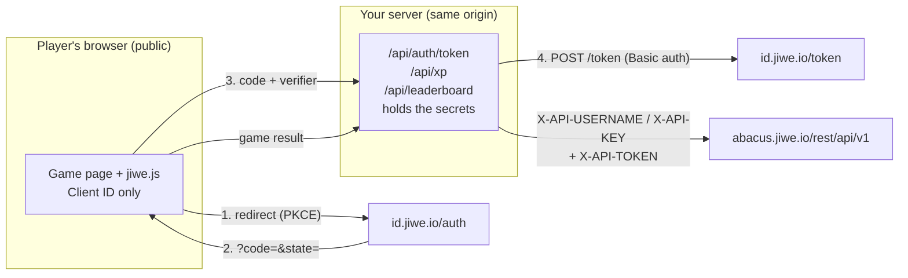

# Integrating Jiwe from a web game (no SDK)

The Unity SDK wraps Jiwe's HTTP API for Unity. A browser game written in plain
JavaScript, React or anything else doesn't need a wrapper: it calls the same endpoints
with `fetch`. This guide is the web version of README §2, §3, §5, §7 and §9, written from
two Jiwe web games. (Swahili Word League is the game [use-cases.md](use-cases.md) calls
Sheng Word League; it was renamed.)

| | Swahili Word League | Paws for Inspection |
|---|---|---|
| Game | React + Node/Express | Vanilla JS, no build step, + one Node file |
| Hosted at | `quirklog.com/` (its own pod on Jiwe's EKS) | `quirklog.com/games/paws-for-inspection/` (its own pod) |
| Login | **Server-driven**: the server builds the Jiwe URL and handles the callback | **Browser-driven**: the page does PKCE; the server only swaps the code |
| Uses Jiwe for | XP, airtime prizes, cowrie purchases, daily pool, leaderboards | XP per level cleared, XP leaderboard |
| Evidence | **Live** since July 2026 | **Built and tested against a fake Jiwe**; leaderboard read checked live; login and XP awaiting their first live run |

Both follow the same rule, and so should yours:

> **The browser gets the Client ID and nothing else.** The Client Secret, the API username
> and the API key live on a server you control. Everything shipped to a browser is public:
> anyone can open the developer tools, copy a key and award XP or airtime from your app.
> Jiwe's own credential screen says the same ("won't expose them in client-side code").

---

## 1. Architecture



**Serve the API from the same origin as the game** (Paws: `/games/paws-for-inspection/api/`
next to the game files, from one Node process). Then:

- the browser needs no CORS, and neither does your server;
- you don't need Jiwe to CORS-whitelist your domain (README §3 says that is a separate request);
- the server can refuse any request whose `Origin` isn't yours.

A Lambda function or any other backend works too. Paws first had a Lambda design and
dropped it, because the game already ran in its own pod and a second service only added a
CORS hop and one more place to keep keys.

---

## 2. Credentials: what goes where

Jiwe's dashboard (Profile → Apps → your app → **New credential**) now shows two blocks
for one environment, e.g. "Paws for Inspection · Production":

| Value | Block | Secret? | Goes into |
|---|---|---|---|
| Client ID | OAuth (sign-in) | no | the browser code **and** the server |
| Client Secret | OAuth (sign-in) | **yes** | server only |
| X-API-USERNAME | Leaderboard, Rewards & Purchases API | **yes** (treat as secret) | server only |
| API Key | Leaderboard, Rewards & Purchases API | **yes** | server only; shown **once**, save it immediately |

On Kubernetes, put the secret values in a Secret and load it with `envFrom`. Mark it
`optional: true` so the game still starts without it, with Jiwe switched off (§7):

```yaml
# k8s/prod/deployment.yaml (Paws, verbatim)
envFrom:
  - secretRef:
      name: paws-for-inspection-secrets
      optional: true
```

```bash
# Run by a person, never committed (Paws docs/JIWE_SETUP.md)
kubectl -n jiweio create secret generic paws-for-inspection-secrets \
  --from-literal=JIWE_CLIENT_ID='...' --from-literal=JIWE_CLIENT_SECRET='...' \
  --from-literal=JIWE_API_USERNAME='...' --from-literal=JIWE_API_KEY='...'
```

**Copy only the game's files into the image.** Paws' Dockerfile lists them one by one, so
docs, tests and k8s files never become public URLs:

```dockerfile
COPY server/jiwe.mjs server/server.mjs ./server/
COPY index.html game.js story.js tutorial.js audio.js jiwe.js style.css manifest.webmanifest ./public/
COPY art ./public/art
```

**If a secret is pasted into a chat, a ticket or a commit, rotate it.** Make a new
credential in the dashboard and update the Secret; nothing else in the game changes.

---

## 3. Redirect URIs on the web

Register the **exact** URL Jiwe sends the player back to, one entry per environment,
byte for byte, including the trailing slash:

| Environment | Paws registers |
|---|---|
| Production | `https://quirklog.com/games/paws-for-inspection/` |
| Local | `http://localhost:8940/games/paws-for-inspection/` (always the same port) |

- **Browser-driven login** (Paws) returns to the game page itself. Compute it the same way
  every time: origin + path without the file name, no query string.
- **Server-driven login** (Swahili Word League) returns to a server route such as
  `https://quirklog.com/games/swahiliwordleague/auth/callback`.
- **The server must check `redirect_uri` against its own allowlist** before swapping a
  code, so nobody can use your server to finish a login started elsewhere.
- Scopes: check every one you request in the app form: `openid`, `profile`, and both
  "Include the user's wallet ID in the token" boxes (`in-app-purchases`, `rewards`). See README §3.

---

## 4. Login, step by step (browser-driven, Paws)

### 4.1 Start: PKCE in the page

The verifier is random, stays in `sessionStorage` across the redirect, and only leaves the
device once, when the server swaps the code. **Verbatim (Paws `jiwe.js`).**

```js
const JIWE_CLIENT_ID = '<your client id>';   // public
const gameUrl = () => `${location.origin}${location.pathname.replace(/[^/]*$/, '')}`;

async function login() {
  const verifier = base64Url(crypto.getRandomValues(new Uint8Array(32)));
  const challenge = base64Url(await crypto.subtle.digest('SHA-256', new TextEncoder().encode(verifier)));
  const state = base64Url(crypto.getRandomValues(new Uint8Array(16)));
  sessionStorage.setItem('paws_jiwe_pending', JSON.stringify({ verifier, state }));
  const params = new URLSearchParams({
    response_type: 'code',
    client_id: JIWE_CLIENT_ID,
    redirect_uri: gameUrl(),
    scope: 'openid profile in-app-purchases rewards',
    state,
    code_challenge: challenge,
    code_challenge_method: 'S256'
  });
  location.href = `https://id.jiwe.io/auth?${params.toString()}`;
}
```

Navigate the **same tab** (`location.href`), not a popup or `window.open`: JiweChess
found a second tab leaves the first one waiting forever (README §7).

No `resource` parameter: both web games send the **ID token** as `X-API-TOKEN` (§5), which
works without one. README §7 explains when an audienced access token is needed instead.

### 4.2 Back on the page: check `state`, clean the URL, hand the code to your server

**Verbatim (Paws), abridged.**

```js
async function finishLogin() {
  const query = new URLSearchParams(location.search);
  if (!query.has('code') && !query.has('error')) return null;
  history.replaceState(null, '', gameUrl());          // the code is single-use; don't leave it in the address bar
  if (query.get('error')) return { error: 'Jiwe login was cancelled or refused.' };

  const pending = JSON.parse(sessionStorage.getItem('paws_jiwe_pending') || 'null');
  sessionStorage.removeItem('paws_jiwe_pending');
  if (!pending || pending.state !== query.get('state')) return { error: 'Login expired. Please try again.' };

  const res = await fetch(api('auth/token'), {
    method: 'POST',
    headers: { 'Content-Type': 'application/json' },
    body: JSON.stringify({ code: query.get('code'), codeVerifier: pending.verifier, redirectUri: gameUrl() })
  });
  const data = await res.json();                       // { idToken, profile: { sub, nickname }, expiresAt }
  localStorage.setItem('paws_jiwe_session', JSON.stringify(data));
}
```

### 4.3 On the server: swap the code with Basic auth

Client authentication goes in the `Authorization: Basic` header **only**. Jiwe answers
`400 client authentication must only be provided using one mechanism` if it is also in the
body, and the body must be form-urlencoded, not JSON. **Verbatim (Paws `server/jiwe.mjs`).**

```js
export async function exchangeCode({ code, codeVerifier, redirectUri }) {
  if (!code || !codeVerifier || !ALLOWED_REDIRECTS.includes(redirectUri)) {
    return [400, { error: 'invalid_request' }];
  }
  const basic = Buffer.from(`${process.env.JIWE_CLIENT_ID}:${process.env.JIWE_CLIENT_SECRET}`).toString('base64');
  const res = await fetch('https://id.jiwe.io/token', {
    method: 'POST',
    headers: { Authorization: `Basic ${basic}`, 'Content-Type': 'application/x-www-form-urlencoded' },
    body: new URLSearchParams({ grant_type: 'authorization_code', code, redirect_uri: redirectUri, code_verifier: codeVerifier })
  });
  const data = await res.json().catch(() => ({}));
  if (!res.ok || !data.id_token) return [502, { error: data.error || 'token_exchange_failed' }];

  const claims = decodeJwt(data.id_token);              // never call /me, see 4.4
  if (!claims || !claims.sub) return [502, { error: 'no_subject' }];
  return [200, {
    idToken: data.id_token,
    profile: { sub: claims.sub, nickname: claims.nickname || claims.preferred_username || claims.name || 'Inspector' },
    expiresAt: claims.exp ? claims.exp * 1000 : Date.now() + 15 * 60 * 1000
  }];
}
```

> **Which secret goes in the Basic header?** Swahili Word League, live since July, sends
> `JIWE_CLIENT_ID:JIWE_API_KEY`. That app predates the dashboard's separate "Client Secret"
> field, and Jiwe support confirmed the old "API Secret" column displayed the wrong value
> (README §9). Paws, created on the new credential screen, sends the **Client Secret**. Until
> Paws' first live login confirms it, treat this row as unverified. If the token exchange
> returns `401 invalid_client`, try the API key in the same slot and record which one worked.

### 4.4 Read the profile from the ID token, not `/me`

Jiwe's `/me` has been seen rejecting every token (confirmed live 2026-09-14). Decode the
ID token's claims and key every player record by `sub`:

```js
export function decodeJwt(token) {
  try {
    const part = String(token).split('.')[1];
    return JSON.parse(Buffer.from(part.replace(/-/g, '+').replace(/_/g, '/'), 'base64').toString('utf8'));
  } catch (e) {
    return null;
  }
}
```

Decoding is not verifying. That's acceptable here because every call that matters sends the
token back to Jiwe as `X-API-TOKEN`, and Jiwe verifies it: a forged token fails at Jiwe and
earns nothing. If you make a decision on `sub` alone without calling Jiwe (for example
"has this player already claimed today?"), verify the token's signature first.

### Server-driven login (Swahili Word League)

The alternative: the browser goes to `/auth/login` on your server, the server builds the
Jiwe URL (PKCE verifier in an httpOnly cookie) and the redirect URI points back to the
server's `/auth/callback`, which swaps the code and sets a session cookie. More moving
parts (sessions, cookies), but the ID token never reaches the browser. Choose it when the
server already keeps sessions; choose browser-driven when the game is static files.
See [use-cases.md §2.1](use-cases.md#21-signing-in-from-a-server).

---

## 5. XP rewards: the server decides the amount

The browser reports **what happened** (level 3 cleared with an S); the server decides **what
it's worth**. A modified client can send anything, so never accept an amount from it.
**Verbatim (Paws), abridged.**

```js
export const XP_BY_GRADE = { S: 50, A: 40, B: 30, C: 20, D: 10 };
const paid = new Map();                                 // `${sub}:${shift}` -> XP already paid

export async function reportXp({ idToken, shift, grade }) {
  const claims = decodeJwt(idToken);
  if (!claims || !claims.sub) return [401, { error: 'not_logged_in' }];
  if (claims.exp && claims.exp * 1000 < Date.now()) return [401, { error: 'expired' }];
  const full = XP_BY_GRADE[grade];
  if (!Number.isInteger(Number(shift)) || shift < 1 || shift > 10 || !full) return [400, { error: 'invalid_result' }];

  // A replay only earns the difference to the best grade already paid: A then S = 40 + 10.
  const key = `${claims.sub}:${shift}`;
  const xp = full - (paid.get(key) || 0);
  if (xp <= 0) return [200, { xp: 0, already: true }];

  const res = await fetch(`${API_BASE}/rewards/xp`, {
    method: 'POST',
    headers: {
      'X-API-USERNAME': process.env.JIWE_API_USERNAME,
      'X-API-KEY': process.env.JIWE_API_KEY,
      'X-API-TOKEN': idToken,                            // the ID token, as both web games send it
      'Content-Type': 'application/json'
    },
    body: JSON.stringify({
      xpEarned: xp,
      description: `Paws for Inspection · Shift ${shift} · ${grade}-rank`,
      gameSessionId: `paws-shift-${shift}-${grade}`,
      metadata: { shift, grade }
    })
  });
  const data = await res.json().catch(() => ({}));
  if (!res.ok || data.type === 'ERROR') return [res.status === 401 ? 401 : 502, { error: data.message || 'xp_failed' }];
  paid.set(key, full);
  return [200, { xp }];
}
```

- **Where "already paid" lives decides how strong the cap is.** Paws keeps it in memory
  (lost on a pod restart) plus a copy in the player's `localStorage`. That's enough for XP,
  which has no cash value. For airtime, cowrie or anything else with money behind it, use a
  durable store and Swahili Word League's reserve-before-pay pattern
  ([use-cases.md §2.4](use-cases.md#24-reserve-before-you-pay--the-part-a-client-cant-do)).
- **Check `type === 'ERROR'` as well as the status.** Jiwe sometimes reports a failure in a
  200 body.
- On `401`, drop the stored session and send the player back through login: a public web
  client has no refresh token, and the ID token lasts minutes, not days.

---

## 6. The leaderboard: read with the app key, rank it yourself

The leaderboard is app-scoped: no player login is needed, so it can be shown to guests.
It still needs the API username and key, so it's a server route too.

```js
const res = await fetch(`${API_BASE}/leaderboard`, {
  method: 'POST',
  headers: { 'X-API-USERNAME': process.env.JIWE_API_USERNAME, 'X-API-KEY': process.env.JIWE_API_KEY, 'Content-Type': 'application/json' },
  body: JSON.stringify({ rewardType: 'xp', maxEntries: 1000, bestPointsRanking: 'highest' })
});
// data.leaderboard: [{ id, username, XP | currentXP | xp, ... }]
```

Then **rank it yourself.** The score field changes with the board (`XP`, `currentXP`, or
`xp` in doc samples), and server order isn't guaranteed (README §5). **Verbatim (Paws).**

```js
export function rankFromLeaderboard(entries, sub) {
  const pointsOf = (e) => e.XP ?? e.currentXP ?? e.xp ?? 0;
  const sorted = [...entries].sort((a, b) => pointsOf(b) - pointsOf(a));
  const index = sub ? sorted.findIndex(e => e.id === sub) : -1;
  const total = sorted.length;
  const rank = index >= 0 ? index + 1 : null;
  return {
    total, rank,
    xp: index >= 0 ? pointsOf(sorted[index]) : 0,
    // Only claim a percentile once enough players exist for it to mean something.
    topPercent: rank && total >= 20 ? Math.max(1, Math.ceil((rank / total) * 100)) : null,
    top: sorted.slice(0, 10).map((e, i) => ({ rank: i + 1, name: e.username || 'Inspector', xp: pointsOf(e), you: Boolean(sub) && e.id === sub }))
  };
}
```

- The player's row is matched by `sub` (the leaderboard entry's `id`).
- **Never invent a percentile.** With 12 players, "Top 8%" is meaningless; show "#1 of 12".
- **Cache the board for a short time** (Paws: 30 s) and clear the cache after an XP award,
  so opening the menu doesn't call Jiwe every time.
- **Points across levels, plus a high score.** Jiwe's board ranks total XP, which is
  exactly "points adding up across stages". Paws also shows the player's XP per level from
  its own record, and keeps the arcade high score as a personal best on the device. A public
  high-score board for a second mode would need its own store; Jiwe ranks XP and cowrie,
  not arbitrary scores.

---

## 7. Switch it on from the server, not a flag in the bundle

Paws' page asks the server whether it holds keys, and shows nothing Jiwe-related until it
does. The same image runs locally with no secrets, in production before the Secret exists,
and in production after, with no rebuild:

```js
// server
if (route === 'config') return sendJson(res, 200, { enabled: configured() }); // all four env vars present
// browser
const res = await fetch(api('config'));
isEnabled = res.ok && (await res.json()).enabled === true;
```

Swahili Word League does the same job with mock switches (`JIWE_MOCK_AIRTIME`,
`JIWE_MOCK_LEADERBOARD`) so development never spends real airtime
([use-cases.md §2.5](use-cases.md#25-mock-modes-for-development)).

---

## 8. Testing without touching Jiwe

Replace `fetch` for calls leaving for `jiwe.io`, run your real server on a random port, and
assert on what it **sends** to Jiwe as well as what it returns. Paws' suite
(`node --test server/server.test.mjs`, 10 tests, no dependencies) covers:

- the token exchange uses Basic auth, a form body and **no** `client_secret` in the body;
- an unknown `redirect_uri` is refused **without** calling Jiwe;
- XP comes from the grade table even when the request asks for 999999;
- a replay earns only the difference; expired tokens and bad results never reach Jiwe;
- ranking reads all three score fields and only shows a percentile with 20+ players;
- the leaderboard is cached; requests from another `Origin` get 403;
- the static server doesn't serve files outside the game folder.

Before a deploy, one **read-only** live call proves the API username and key without
touching any player:

```bash
curl -s -X POST https://abacus.jiwe.io/rest/api/v1/leaderboard \
  -H "X-API-USERNAME: $JIWE_API_USERNAME" -H "X-API-KEY: $JIWE_API_KEY" -H 'Content-Type: application/json' \
  -d '{"rewardType":"xp","maxEntries":5,"bestPointsRanking":"highest"}'
# {"type":"OK", "leaderboard":[...]}  - an empty list is normal for a new app
```

---

## 9. Web security checklist

- [ ] **Only the Client ID is in the browser.** Search the built bundle for your API key
      before the first deploy.
- [ ] **Secrets come from the environment** (a Kubernetes Secret, Lambda variables), never
      from a committed file. Rotate any that were pasted anywhere.
- [ ] **The server sets every amount.** XP, airtime and prices come from server-side tables;
      the browser only reports what the player did.
- [ ] **Caps are keyed by `sub`** and live where a modified client can't reset them. Durable
      storage for anything with money behind it.
- [ ] **`redirect_uri` is checked against an allowlist** before a code swap.
- [ ] **`state` is checked** on the way back, and the single-use `?code=` is removed from the URL.
- [ ] **Same origin, or a strict `Origin` check.** Reject requests from other sites.
- [ ] **Small request bodies** (Paws caps at 8 KB) and no stack traces in error responses.
- [ ] **Never call `/me`**; read the ID token. Don't trust its claims for decisions Jiwe
      doesn't re-check.
- [ ] **Only real data in rankings.** No estimated percentiles.

---

## 10. Paws for Inspection, start to finish

What it took to add login, XP and a leaderboard to a static game already running on
Jiwe's cluster:

1. **Jiwe dashboard:** one app, one production credential, redirect URIs for production and
   localhost.
2. **Server** (`server/jiwe.mjs` + `server/server.mjs`, ~290 lines, no dependencies): replaced
   nginx with one Node process that serves the same files and four API routes.
3. **Browser** (`jiwe.js`, ~140 lines): PKCE login, the callback, XP after each cleared level,
   the leaderboard.
4. **UI:** "Log in with Jiwe" and "Leaderboard" on the menu; the XP earned and the player's
   rank on the end-of-level report; a leaderboard screen with the top 10, the player's own
   row, their XP per level and their personal high score.
5. **Kubernetes:** an optional `envFrom` Secret and a memory limit raised from 64 to 128 MiB
   for Node. CI only swaps images, so that manifest change is applied by hand once, **before**
   the first Node image ships.
6. **Then:** create the Secret, restart, log in once, clear a level, and check the XP lands
   on the board. That first live run is what turns §4.3's open question into a fact.
